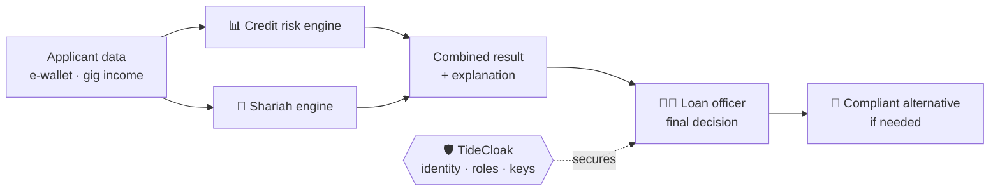

<div align="center">

# 🌙 BAYAN · بَيَان

### Shariah-compliant credit for gig workers — *even if we are breached.*

**RMIT Hackathon 2026 · Challenge 2 (Tide) · Taylor's University · Team [TEAM NAME]**

[](./video.mp4)
[](./summary.docx)
[](./sourcecodes.zip)

</div>

---

## 🎬 Demo video

**[▶ Watch the 2-minute demo (video.mp4)](./video.mp4)**

<!-- Drag video.mp4 here in the GitHub editor to embed a player -->

---

## 📦 Submission

| Required | File | Contents |
|---|---|---|
| Source code | [`sourcecodes.zip`](./sourcecodes.zip) | BAYAN web app (`src/`, Vite + React + TypeScript) and the TideCloak-secured version (`tidecloak-integration/`) |
| Summary | [`summary.docx`](./summary.docx) | Problem, solution, value and role of TideCloak |
| Video | [`video.mp4`](./video.mp4) | Two-minute working demonstration |
| Run instructions | [How to run ↓](#-how-to-run-and-test) | How to launch and test the prototype |

---

## 🧩 The problem

Many gig workers in Malaysia — **Grab drivers, Foodpanda riders, freelancers** and B40 households — are refused Islamic financing because they have **no payslips**.

Banks *can* assess them on **alternative data** (e-wallet flows, gig income, IC numbers, bank details)… but collecting it turns the bank's lending platform into a **honeypot**.

## 🔐 The trust constraint

> **The most dangerous actor is whoever holds the keys** — including the bank's own admins and database.

| | Threat |
|---|---|
| 🔓 **Privacy** | A database breach exposes every applicant's IC number and finances |
| 🗝️ **Custody** | Whoever holds the keys — password database, admin, server — can read everything |
| 👤 **Authority** | An officer approves their own loan · one phished admin grants themselves officer power |
| 🧾 **Trust** | Audit logs admins can quietly edit · prompt injection hidden in applicant text |

## 💡 The solution

BAYAN is a credit-assessment platform used **inside Islamic banks by loan officers**. Every application runs through two engines, and the **officer always makes the final decision** — BAYAN never auto-approves.

| Engine | What it does |
|---|---|
| 📊 **Credit risk engine** | Scores applicants on alternative income data, with **SHAP-style explanations** of each factor |
| 🕌 **Shariah engine** | Screens the financing for **riba, gharar and maysir** |
| 🔁 **Smart product substitution** | Instead of a dead-end rejection, proposes a compliant alternative (e.g. **Tawarruq**, **Ijarah**, **Murabahah**) |
| 🧑‍⚖️ **Human in the loop** | Loan officer decides; Shariah council and reports provide oversight |



### Screens in the web app

| Screen | Route |
|---|---|
| Officer sign-in | `/login` |
| Dashboard (application queue & metrics) | `/dashboard` |
| New assessment | `/assessment/new` |
| Dual-engine processing | `/assessment/processing` |
| Assessment result (credit score + Shariah verdict) | `/assessment/:id/result` |
| Shariah-compliant alternative product | `/assessment/:id/alternative` |
| Application history / audit | `/history` |
| Reports | `/reports` |
| Shariah council | `/shariah-council` |
| Settings · Help & support | `/settings` · `/help-support` |

## 🛡️ Why TideCloak matters

The TideCloak-secured version is in [`tidecloak-integration/`](./tidecloak-integration) (Next.js + `@tidecloak/nextjs`), with three separated roles: **applicant**, **credit officer** and **Shariah auditor**.

| Threat | Conventional login | **BAYAN + TideCloak** |
|---|---|---|
| Password database leak | Hashes stolen | **No password DB** — keys split across the Tide network, no one holds them |
| Rogue DBA reads IC numbers | Plaintext or server-held keys | Vault encrypted in the browser with Tide — **server sees only ciphertext** |
| One phished admin escalates | Grants self officer role | Role grants need **quorum approval** |
| Forged requests | Browser checks bypassed | Signed token + role **verified server-side** on every page and API |
| Officer approves own loan | Possible | **Segregation of duties** enforced on the server and logged |
| Edited records | Undetectable | **SHA-256 hash-chained** audit trail — tampering is detected |

Key code: [`proxy.ts`](./tidecloak-integration/proxy.ts) · [`lib/server/auth.ts`](./tidecloak-integration/lib/server/auth.ts) · [`init/realm.json`](./tidecloak-integration/init/realm.json)

## 🌍 Value & impact

- ✅ **Financial inclusion:** fair, explainable Islamic credit for workers excluded by payslip-based scoring
- ✅ **No honeypot:** banks can use alternative data without exposing it
- ✅ **No dead ends:** non-compliant requests receive a compliant alternative product
- ✅ **Regulator-ready:** human-in-the-loop decisions, role separation and tamper-evident audit fit BNM RMiT and Shariah governance

---

## ▶ How to run and test

### 1 · BAYAN web app (repository root)

Requirements: **Node.js 22 LTS** or **Bun**.

```bash
bun install          # or: npm install
bun run dev          # or: npm run dev  → open the URL shown in the terminal
```

**Test it:**
1. On the sign-in page, keep the pre-filled officer ID and click **Sign in** (demo login).
2. **Dashboard** → start a **New assessment** → watch the **dual-engine processing**.
3. Open the **result**: credit score with factor explanations and the Shariah verdict.
4. For a non-compliant case, open the **alternative product** suggestion.
5. Check **History**, **Reports** and **Shariah council**.

### 2 · TideCloak-secured version (`tidecloak-integration/`)

```bash
cd tidecloak-integration
npm install          # or: bun install
npm run dev          # → http://localhost:3000
```

Starts in **demo mode** without a TideCloak server: pick **Applicant**, **Credit officer** or **Auditor** (role checks still run on the server). Try:
- As **Applicant**, open `/officer` → **Access denied**
- As **Officer**, open `APP-2026-0906` (prompt injection flagged) and `APP-2026-0902` → approval blocked → **Offer Tawarruq**
- As **Auditor** → **Chain intact ✓**

**With a real TideCloak server:**
```bash
docker run --name mytidecloak -d -p 8080:8080 \
  -e KC_BOOTSTRAP_ADMIN_USERNAME=admin -e KC_BOOTSTRAP_ADMIN_PASSWORD=password \
  tideorg/tidecloak-dev:latest
bash init/tcinit.sh            # full Tide mode (requires Tide's licence service)
bash init/standard-setup.sh    # or: TideCloak standard sign-in · aisyah / officer.hafiz / auditor.lim · password Bayan@2026
npm run dev
```
Full guide: [`tidecloak-integration/README.md`](./tidecloak-integration/README.md)

---

## ⚠️ Mocked & simulated components

| Component | Status |
|---|---|
| Officer sign-in in the web app | 🟡 **Simulated** — accepts the demo officer ID, no real identity provider |
| Applicant data, applications, dashboard metrics, reports | 🟡 **Simulated** mock data (no backend) |
| Credit risk engine (XGBoost + SHAP) | 🟡 **Simulated** — scores and explanations come from mock data |
| Shariah engine (fatwa-trained LLM) | 🟡 **Simulated** — verdicts come from mock data |
| Demo login in `tidecloak-integration/` (no TideCloak server) | 🟡 **Simulated**, labelled in the app; server-side role checks still enforced |
| Credit score & Shariah screening in `tidecloak-integration/` | 🟡 Transparent rules engine |
| Prompt-injection guard | 🟡 Keyword patterns — production: our Challenge-1 XLM-R classifier (Macro-F1 ≈ 0.97) |
| Tide sign-in, Tide vault encryption, quorum approval | 🔵 **Real code** in `tidecloak-integration/`; at the venue Tide's licence service timed out during realm setup, so the recorded demo runs in demo mode |
| Server-side role verification, segregation of duties, SHA-256 audit chain | 🟢 **Real** application logic in `tidecloak-integration/` |

## 🗂️ Repository structure

```
bayansystem/
├── README.md               ← you are here
├── summary.docx            ← problem · solution · value · role of TideCloak
├── video.mp4               ← 2-minute demo
├── sourcecodes.zip         ← all source code
├── src/  public/           ← BAYAN web app (Vite + React + TypeScript + shadcn/ui)
├── package.json  vite.config.ts  …
└── tidecloak-integration/  ← BAYAN secured with TideCloak (Next.js)
```

<div align="center">

**BAYAN — fair Islamic credit for gig workers. Safe even when breached.**

</div>
